# LiliSphere — Product Requirements Document (PRD)
**Version:** 1.0 (MVP Baseline)  
**Organization:** LiliSare (Mountain Lane & Colorado Home Health)  
**Status:** Approved for Implementation  
**Target Delivery:** Phased Rollout (Release 1, 2, 3)

---

## 1. Executive Summary & Business Context

### 1.1 Background
LiliSare is the combined healthcare organization formed from the merger of **Mountain Lane** and **Colorado Home Health**, supporting individuals with intellectual and developmental disabilities, children with special healthcare needs, and disabled adults in home settings across Colorado (Denver, Aurora, Lakewood, Boulder, Colorado Springs, and rural communities).

### 1.2 The Core Operational Model
* **Caregiver Population:** ~900+ active caregivers.
* **Client Population:** ~500 clients (including rural Frisco cohort).
* **The Unique Dynamic:** Approximately **90% of caregivers are family members** (e.g., parents acting as paid caregivers for disabled children, or adult children supporting disabled elderly parents).
* **Household vs. Legal Record Separation:** Clients and caregivers commonly share residences and demographic data, but state Medicaid compliance requires **completely separate, HIPAA-isolated records** for client plans of care vs. caregiver employment credentials.

### 1.3 Core Problem & Business Drivers
* **Current Bottleneck:** Caregiver and client onboarding is currently managed by a **two-person internal team** using manual paperwork, spreadsheets, and document chasing.
* **Fragmented Legacy EHR Landscape:** Operating 3 disparate legacy systems (**AxisCare**, **KanTime**, and **Frisco**) creates data silos, duplicated entries, and high recurring vendor licensing fees ($1,400–$2,800/month).
* **Missed Clock-Out Crisis:** Caregivers frequently forget to clock out in AxisCare, forcing office staff to manually investigate and correct hours.
* **Payment at Risk:** Caregivers cannot be paid until state Prior Authorization Requests (PAR) and case-manager service plans arrive.
* **Growth Mandate:** Scale operational capacity to serve **3x to 4x more families** without proportionally increasing administrative headcount.

---

## 2. Product Objectives & Success Metrics

| Objective | Target Metric | Measurement Method |
| :--- | :--- | :--- |
| **Accelerate Onboarding** | Reduce average caregiver onboarding cycle from **21 days to < 7 days** | Intake timestamp to activation timestamp |
| **Eliminate Manual Clock-Out Chasing** | **95%+ self-correction rate** for missed clock-outs | Percentage of EVV exceptions resolved directly by caregivers |
| **Medicaid First-Pass Clean Claims** | Achieve **> 98% clean claim rate** on initial state batch | Remittance advice adjudication codes |
| **Legacy System Retirement** | Decommission AxisCare, KanTime, and Frisco | Successful migration of 7-year audit data to encrypted AWS storage |
| **Operational Scaling** | Support **2,000+ caregivers** with the same 2-person onboarding team | Onboarding staff-to-caregiver throughput ratio |

---

## 3. Scope & Phased Release Roadmap

```mermaid
flowchart LR
    D["Discovery (Wk 1)"] --> R1["Release 1 (MVP)"]
    R1 --> R2["Release 2 (App & EVV)"]
    R2 --> R3["Release 3 (Billing & Migration)"]
    
    subgraph R1_Details["Release 1: Core Platform ($15k / 7-8 wks)"]
        r1a["Intake & Leads Pipeline"]
        r1b["Automated 15/20 Doc Packets"]
        r1c["Household Linked Architecture"]
        r1d["CBI / Background Tracking"]
        r1e["Case-Manager Follow-Ups"]
    end
    
    subgraph R2_Details["Release 2: Mobile & EVV"]
        r2a["Caregiver Mobile App"]
        r2b["Colorado EVV Aggregator (Sandata)"]
        r2c["Self-Service Time Correction"]
        r2d["AI Care Note Coaching (90%+ Acc)"]
        r2e["LearnWorlds LMS Webhook Sync"]
    end
    
    subgraph R3_Details["Release 3: RCM & Data Vault"]
        r3a["Medicaid Dual-NPI Claim Engine"]
        r3b["Commercial Denial Letter Workflow"]
        r3c["ADP Payroll Integration"]
        r3d["7-Year Statutory Audit Migration"]
    end
    
    R1 --- R1_Details
    R2 --- R2_Details
    R3 --- R3_Details
```



### 3.1 Release 1: Core Operations Platform (Current MVP Baseline)
* **Unified Intake Pipeline:** Centralized capture of agency referrals, website inquiries, and family inbound calls.
* **Service-Driven Document Engine:** Automatic assignment of 15-document (attendant/personal care) or 20-document (CNA/dual) compliance packets based on service selection (IHSS, CNA, HMA, Personal Care).
* **Linked Household Data Model:** Shared demographic data without duplicating legal/tax credentials.
* **CBI State Fingerprint & OIG Tracking:** Automated direct screening logs with renewal notifications.
* **State Case-Manager Coordination:** Automated templated follow-ups to protect state prior-authorizations.
* **Role-Based Access Control:** Granular separation across intake, onboarding, clinical, compliance, billing, and executive personas.

### 3.2 Release 2: Caregiver Experience & Colorado EVV
* **Mobile-First Caregiver Portal:** Intuitive dashboard for non-technical family caregivers.
* **Colorado HCPF / Sandata EVV Integration:** Real-time clock-in/out with GPS geofencing.
* **Caregiver Self-Service Time Correction:** Allows caregivers to correct their own missed clock-outs with mandatory reason capture and QA signoff.
* **AI Care Note Dictation:** Voice-to-text dictation with AI compliance scoring against Colorado Medicaid documentation rules.
* **LearnWorlds LMS Sync:** Automated course completion and quiz score ingestion.

### 3.3 Release 3: Revenue Cycle & Legacy Data Migration
* **Medicaid Dual-NPI Billing Engine:** Routing claims dynamically under Mountain Lane (NPI 1) vs. Colorado Home Health (NPI 2) with Class B support.
* **Commercial Denial Letter Management:** Required prerequisite for secondary Medicaid claim submission.
* **ADP Payroll Automation:** Verified EVV hours pushed directly into ADP Run (employees) and ADP Workforce Now (1099 contractors).
* **7-Year Statutory Audit Vault:** Export, transform, and archive 7 years of records from AxisCare, KanTime, and Frisco into encrypted, HIPAA-compliant AWS storage.

---

## 4. Key Functional Requirements

### 4.1 Linked Household Data Model
```
[ Household Unit ]
    ├── [ Client Record: Mateo Morales (Child) ]
    │      ├── Medicaid ID: CO-984421008
    │      ├── Program: IHSS Waiver (28.5 hrs/wk)
    │      ├── Case Manager: Patricia Vance (RMHS)
    │      └── Care Plan & Physician Orders (Form 485)
    │
    └── [ Caregiver Record: Elena Morales (Mother) ]
           ├── Relationship: Mother & Legal Guardian
           ├── Classification: W-2 Family Employee
           ├── Tax & Legal: W-4, I-9, State ID
           ├── Background: CBI Fingerprint, OIG Clearance
           ├── Training: LearnWorlds 6/6 Modules
           └── Payroll: ADP Run Direct Deposit
```
* **Requirement:** The system MUST allow entering shared household address and phone once, while maintaining strictly separated document checklists and completion statuses.
* **Validation:** Client onboarding completion must NOT automatically activate caregiver, and vice versa.

### 4.2 Automated Service-Driven Onboarding Rule Matrix
Staff must **never** manually assemble documents. Selecting the service program triggers the exact workflow:

| Service Program | Required Qualification | Document Packet Size | Background Checks | Supervisory Visit Requirement |
| :--- | :--- | :--- | :--- | :--- |
| **IHSS** (In-Home Support Services) | Family Member Attendant | 15 Documents | CBI Fingerprint + OIG | Quarterly Oversight (Non-RN eligible) |
| **CNA** (Certified Nurse Aide) | DORA Licensed CNA | 20 Documents (Dual) | CBI + OIG + MVR Driving | Initial RN + 60-Day Onsite RN Visit |
| **HMA** (Health Maintenance Activities) | Trained Family Attendant | 18 Documents | CBI + OIG | Initial RN + Quarterly Virtual RN |
| **Personal Care / Homemaker** | Unskilled Attendant | 15 Documents | CBI State Check | Annual In-Home Supervisory Check |

### 4.3 Electronic Visit Verification (EVV) & Self-Correction
* **Mandatory State Aggregator:** Connects using standard Colorado HCPF / Sandata open REST specifications.
* **Geofencing:** GPS radius verification at client residence ($\pm 50$ meters).
* **Self-Service Exception Resolution:** When a clock-out is missed:
  1. Caregiver receives push/SMS alert.
  2. Caregiver inputs actual shift end time and selects reason from dropdown + text notes.
  3. Routed to Onboarding/QA queue.
  4. Once approved, updated units flow into Medicaid claim batch and ADP payroll batch.

---

## 5. Non-Functional & Compliance Requirements

### 5.1 Regulatory & Legal Compliance
* **HIPAA Privacy & Security Rules:** All ePHI encrypted in transit (TLS 1.3) and at rest (AES-256 with AWS KMS).
* **Business Associate Agreement (BAA):** Must be executed before accessing production data.
* **State Statutory Record Retention:** **7-year audit retention** adhering to Colorado Department of Public Health and Environment (CDPHE) 6 CCR 1011-1 and Colorado Medicaid rules.

### 5.2 Performance & Scalability
* **Peak Load Handling:** EVV ingestion engine must support 900+ concurrent clock-in/out requests within a 15-minute window without rate-limit failures or dropped events.
* **Availability:** 99.9% uptime for EVV and Caregiver mobile endpoints.
* **Response Times:** Dashboard query latency $< 300\text{ms}$; EVV GPS check-in confirmation $< 1.5\text{s}$.
