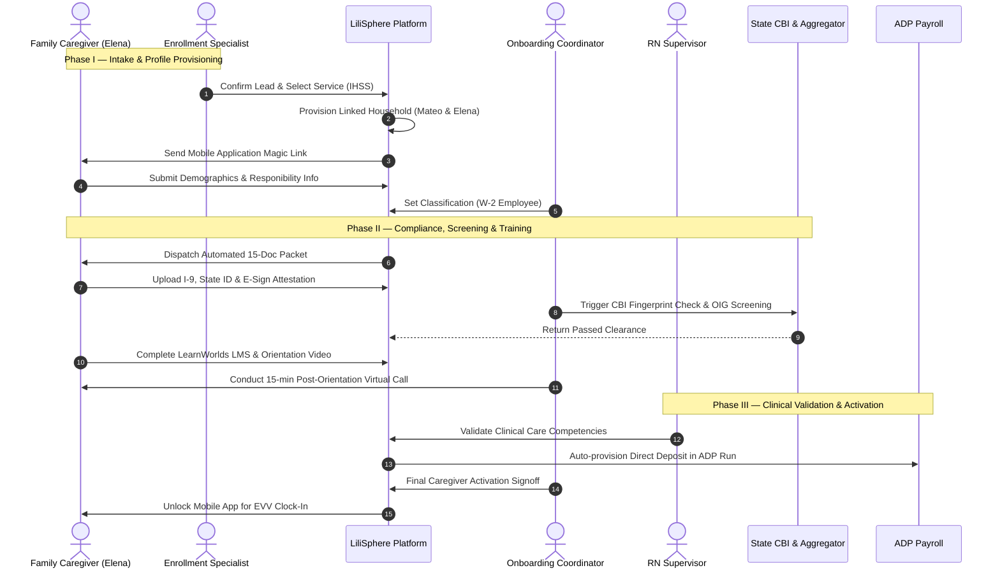
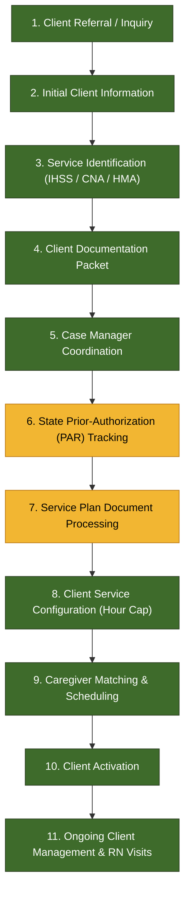
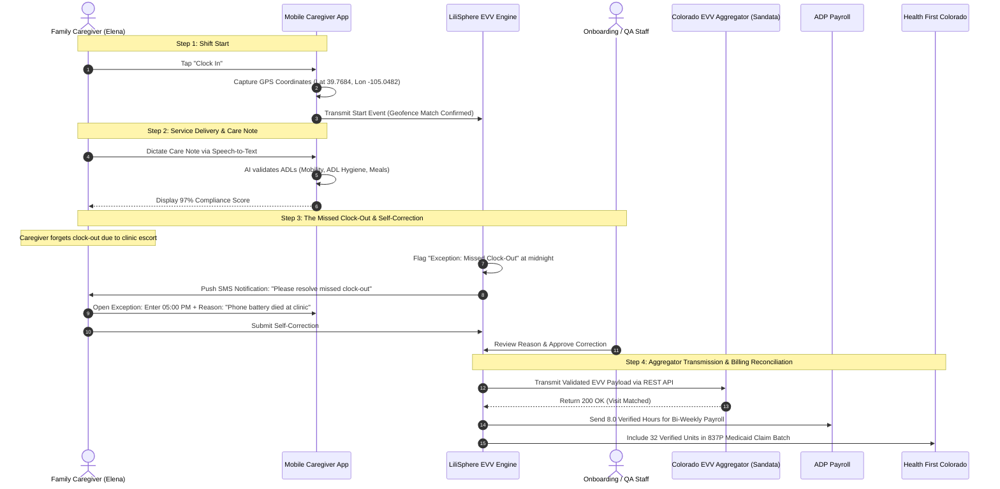
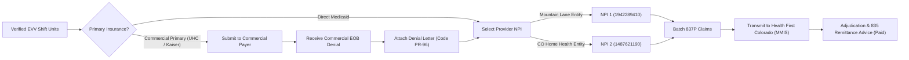

# LiliSphere — Comprehensive User Flows & Journeys (USER_FLOWS.md)
**Version:** 1.0  
**Classification:** Core Operational Lifecycle Specification

---

## 1. Executive Journey Overview

This document specifies the four core operational journeys that govern LiliSphere:
1. **Caregiver Onboarding Journey (15 Steps across 4 Phases)**
2. **Patient / Client Onboarding Flow (11 Milestones)**
3. **EVV Shift Delivery, Missed Clock-Out Self-Correction & State Reconciliation**
4. **Intake-to-Medicaid-Billing & Dual-NPI Claims Flow**

---

## 2. Journey 1: Caregiver Onboarding Journey (15 Steps)

### Detailed Step-by-Step Breakdown

#### Phase I: Intake & Onboarding Setup
* **Step 1: Lead Confirmation**
  * *Trigger:* Family selects LiliSare.
  * *Actor:* Enrollment Specialist.
  * *Action:* Mark lead status as "Converted" in unified pipeline.
* **Step 2: Internal Notification**
  * *Trigger:* Lead conversion.
  * *Actor:* System Automation.
  * *Action:* Automatically generates caregiver intake task in Onboarding dashboard.
* **Step 3: Caregiver Application Dispatch**
  * *Actor:* Onboarding Coordinator.
  * *Action:* One-click dispatch of personalized mobile onboarding application via SMS/Email.
* **Step 4: Application Completion**
  * *Actor:* Family Caregiver (Mobile).
  * *Action:* Caregiver inputs basic contact details, date of birth, and verifies existing household address.
* **Step 5: Caregiver Profile Creation**
  * *Actor:* System Automation.
  * *Action:* Creates permanent caregiver record linked to client ID (reusing address, isolating SSN/tax data).
* **Step 6: Determine Caregiver Classification**
  * *Actor:* Onboarding Coordinator.
  * *Action:* Classify as W-2 Employee (standard IHSS/CNA), 1099 Contractor, or Dual (Employee + Contractor).

#### Phase II: Compliance, Training & Authorization
* **Step 7: Send Relevant Documentation Packet**
  * *Actor:* System Automation.
  * *Action:* Service rule automatically compiles packet (15 docs for IHSS; 20 docs for CNA/Dual).
* **Step 8: Document Uploads & Electronic Signature**
  * *Actor:* Family Caregiver.
  * *Action:* Uploads driver's license, I-9 documents, and digitally signs mutual care agreements.
* **Step 9: Background Screening (CBI & Federal)**
  * *Actor:* System / Compliance Lead.
  * *Action:* API sends screening request to Colorado Bureau of Investigation (CBI) and verifies OIG list.
* **Step 10: LearnWorlds Training & Quizzes**
  * *Actor:* Family Caregiver & LearnWorlds LMS.
  * *Action:* Caregiver completes assigned modules (infection control, client rights, EVV procedures). Webhook posts test scores to LiliSphere.
* **Step 11: Orientation Video**
  * *Actor:* Family Caregiver.
  * *Action:* Watches required orientation video; video player logs 100% completion timestamp.
* **Step 12: Post-Orientation Virtual Meeting**
  * *Actor:* Onboarding Coordinator & Caregiver.
  * *Action:* 15-minute introductory video check-in to confirm EVV readiness and answer questions.

#### Phase III: Activation & Service Delivery
* **Step 13: Clinical Skills Validation**
  * *Actor:* RN Clinical Supervisor.
  * *Action:* Nurse reviews caregiver competency for specific client tasks (transfers, hygiene, enteral care).
* **Step 14: ADP Payroll Profile Creation**
  * *Actor:* System Automation / Payroll.
  * *Action:* Verified profile, W-4 tax withholding, and direct deposit pushed to ADP Run or ADP Workforce Now.
* **Step 15: Caregiver Activation & EVV Release**
  * *Actor:* Onboarding Lead & System.
  * *Action:* Sets caregiver to "Active & Activated". Shifts become visible in mobile app for EVV clock-in.

---

## 3. Journey 2: Patient / Client Onboarding Flow (11 Milestones)

### Detailed Milestone Specifications

* **Milestone 1: Client Referral / Inquiry**
  * Captures inquiry source (Case Management Agency, direct referral, website, family phone call).
* **Milestone 2: Initial Client Information**
  * Gathers patient demographics, Medicaid number, primary language, and legal guardian/responsible party details.
* **Milestone 3: Service Identification**
  * Determines the exact Medicaid waiver program (HCBS-EBD, CES, CFC, IHSS) and required clinical supervision.
* **Milestone 4: Client Documentation**
  * Dispatches client-specific packet (Client Rights, Freedom of Choice, Physician Order Form 485).
* **Milestone 5: Case Manager Coordination**
  * Establishes direct connection with the state case manager (RMHS, Imagine!, TRE) and logs communication history.
* **Milestone 6: State Prior-Authorization (PAR)**
  * Tracks submission and receipt of state prior-authorization. System triggers proactive follow-ups so care is not delayed.
* **Milestone 7: Service Plan Processing**
  * Ingests and extracts the state-approved service plan, digitizing authorized weekly unit allocations and task matrix.
* **Milestone 8: Client Service Configuration**
  * Locks in authorized hours per week, active start/end dates, and supervisory visit frequency in LiliSphere.
* **Milestone 9: Caregiver Matching & Scheduling**
  * Matches verified, active family caregiver(s) to the client and sets up the recurring shift schedule.
* **Milestone 10: Client Activation**
  * Final activation flag set to "Active". Care delivery commences with authorized EVV shift coverage.
* **Milestone 11: Ongoing Client Management**
  * Schedules mandatory 60-day RN visits, quarterly reviews, annual plan re-evaluations, and state audit archiving.

---

## 4. Journey 3: EVV Shift Delivery, Missed Clock-Out Self-Correction & State Reconciliation

---

## 5. Journey 4: Intake-to-Medicaid-Billing & Dual-NPI Claims Flow

