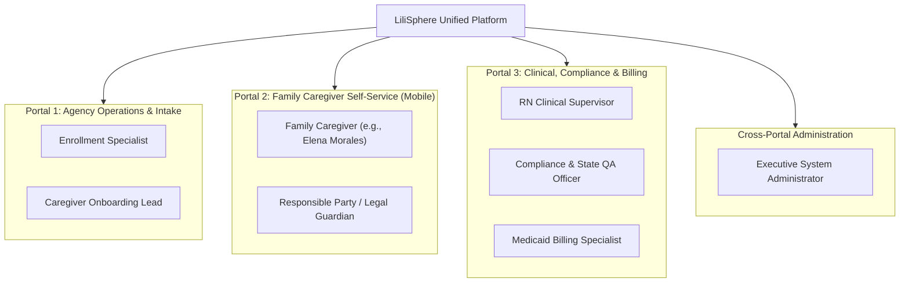

# LiliSphere — User Roles & Three-Portal Architecture (USER_ROLES.md)
**Version:** 1.0  
**Classification:** Operational Security & Access Control Reference

---

## 1. The Three-Portal Ecosystem

LiliSphere is structured into **three specialized, role-scoped portals** to eliminate clutter, enforce HIPAA data isolation, and guarantee that users only see what is relevant to their responsibilities:

---

## 2. Portal 1: Agency Operations & Intake Portal

### 2.1 Persona 1: Enrollment Specialist
* **Primary Objective:** Capture, qualify, and convert new family and agency inquiries into confirmed LiliSare clients.
* **Key Responsibilities:**
  * Monitor inquiries across Case Management Agencies (RMHS, Imagine!, TRE, Boulder County), direct referrals, and web forms.
  * Conduct initial family intake calls to assess client care requirements and waiver eligibility.
  * Establish direct channels with State Case Managers to initiate Prior Authorization Requests (PAR).
  * Convert confirmed inquiries directly into the onboarding workflow.
* **Allowed Modules & Screens:**
  * `/intake/leads` — Unified Referral Pipeline & Follow-up Scheduler
  * `/intake/new` — Quick Client/Caregiver Inquiry Intake Modal
  * `/coordination/case-managers` — State Agency Directory & Automated Follow-Up Dispatch
* **Restricted Modules:**
  * CANNOT view caregiver payroll rates, tax documents (W-4/W-9), or Medicaid billing claim amounts.

### 2.2 Persona 2: Caregiver Onboarding Lead (Danielle Brooks)
* **Primary Objective:** Guide 900+ family caregivers through credentialing, training, and activation with a compact 2-person team.
* **Key Responsibilities:**
  * Review automated service-driven document packets (15 or 20 items).
  * Validate identity documents (Driver's License, Social Security card, I-9).
  * Initiate and track Colorado Bureau of Investigation (CBI) fingerprint checks and OIG exclusions.
  * Verify completion of LearnWorlds LMS coursework and orientation video attendance.
  * Authorize caregiver activation once all 14 prerequisite checklist steps are certified.
* **Allowed Modules & Screens:**
  * `/onboarding/queue` — Caregiver Verification & Checklist Queue
  * `/onboarding/packets` — Automated Service-Based Packet Configuration
  * `/screening/cbi` — CBI Background & Screening Dashboard
  * `/integration/adp` — ADP Payroll Profile Provisioning Status
* **Restricted Modules:**
  * CANNOT submit Medicaid billing claims or modify clinical care plans (Form 485).

---

## 3. Portal 2: Family Caregiver Self-Service Mobile Portal

### 3.1 Persona: Family Caregiver (Elena Morales, Mother of Mateo)
* **Primary Objective:** Provide family members with a simple, respectful, mobile-first experience for time verification, documentation, and compliance.
* **Key Responsibilities:**
  * Clock in and clock out of authorized daily shifts with GPS location matching.
  * Submit self-service time corrections for missed clock-outs without needing office phone calls.
  * Record daily visit notes using AI-assisted speech-to-text dictation.
  * Upload required credential renewals (e.g. CPR certificates, driver's licenses).
  * Complete mandatory LearnWorlds training courses and review care plans.
* **Allowed Modules & Screens:**
  * `/caregiver/today` — Shift Card & GPS-Verified EVV Clock In / Clock Out
  * `/caregiver/exceptions` — Self-Service Missed Clock-Out Resolution
  * `/caregiver/notes` — AI-Assisted Voice Care Note Dictation with Compliance Score
  * `/caregiver/profile` — My Documents, W-4/Direct Deposit status, and Training Modules
* **Strict Privacy Isolation:**
  * Caregiver ONLY sees the specific client(s) they are authorized to care for.
  * Cannot view internal agency audit notes, other caregivers' records, or billing margins.

---

## 4. Portal 3: Clinical, Compliance & Billing Portal

### 4.1 Persona 1: RN Clinical Supervisor (Rebecca Stern, BSN, RN)
* **Primary Objective:** Ensure high standards of clinical care, nurse supervision, and Medicaid documentation compliance.
* **Key Responsibilities:**
  * Conduct and document required 60-day in-home nurse evaluations for CNA clients.
  * Conduct quarterly virtual RN assessments for HMA (Health Maintenance Activities) clients.
  * Validate caregiver clinical skills (enteral nutrition, tracheostomy care, passive ROM).
  * Audit daily caregiver visit notes using AI compliance scoring.
* **Allowed Modules & Screens:**
  * `/clinical/visits` — Supervisory Nurse Visits Matrix (Scheduled, Upcoming, Overdue)
  * `/clinical/assessments` — Form 485 & Plan of Care Review
  * `/clinical/note-audit` — AI Care Note Quality Audit Feed

### 4.2 Persona 2: Compliance Officer
* **Primary Objective:** Guarantee 100% adherence to Colorado CDPHE and Medicaid statutory guidelines and oversee historical data preservation.
* **Key Responsibilities:**
  * Monitor recurring credential expiration dates (CPR, annual TB screening, 3-year CBI renewals).
  * Dispatch automated expiration warning alerts to caregivers (30-day and 7-day triggers).
  * Supervise 7-year audit retention vault and legacy EHR migration status (AxisCare, KanTime, Frisco).
* **Allowed Modules & Screens:**
  * `/compliance/expirations` — Credential Lifecycles & Proactive Notice Center
  * `/compliance/audit-vault` — 7-Year Statutory Data Vault & Legacy Migration Monitor
  * `/compliance/reports` — State Survey & CDPHE Audit Trail Exports

### 4.3 Persona 3: Medicaid Billing Specialist
* **Primary Objective:** Convert verified EVV shift units into paid Medicaid claims without delays or denials.
* **Key Responsibilities:**
  * Route claims under correct billing NPI (Mountain Lane NPI 1 vs. Colorado Home Health NPI 2).
  * Manage commercial primary insurance denial letters (required before Medicaid pays secondary).
  * Batch and transmit clean 837P claims to Health First Colorado (HCPF).
  * Reconcile verified EVV hours against ADP payroll disbursements.
* **Allowed Modules & Screens:**
  * `/billing/claims` — Medicaid Claims Queue & 837 Batch Transmit Engine
  * `/billing/denials` — Commercial Insurer Denial Letter Management
  * `/billing/reconciliation` — EVV Units vs. Payroll Hours Reconciliation Matrix

---

## 5. System Administrator (Cross-Portal Access)
* **Primary Objective:** Oversee system performance, user provisioning, security, and enterprise growth metrics.
* **Permissions:** Full read/write access across all three portals, system audit logs, integration telemetry, and security policy management.
* **Allowed Modules & Screens:**
  * `/admin/telemetry` — Multi-Entity Health (Colorado EVV, ADP, LearnWorlds)
  * `/admin/audit-log` — Immutable HIPAA Access Log
  * `/admin/settings` — Service Rules, Document Matrix & Automation Triggers

---

## 6. Permissions & Access Control Matrix

| Feature / Action | Enrollment | Onboarding | Caregiver (Mobile) | Clinical RN | Compliance | Billing | Admin |
| :--- | :---: | :---: | :---: | :---: | :---: | :---: | :---: |
| **Create Referral Lead** | ✅ | ❌ | ❌ | ❌ | ❌ | ❌ | ✅ |
| **Send Case-Manager Follow-Up** | ✅ | ❌ | ❌ | ❌ | ❌ | ❌ | ✅ |
| **Verify Onboarding Documents** | ❌ | ✅ | ❌ | ❌ | ❌ | ❌ | ✅ |
| **Trigger CBI Background Check**| ❌ | ✅ | ❌ | ❌ | ✅ | ❌ | ✅ |
| **Activate Caregiver Profile** | ❌ | ✅ | ❌ | ❌ | ❌ | ❌ | ✅ |
| **EVV Clock-In / Clock-Out** | ❌ | ❌ | ✅ | ❌ | ❌ | ❌ | ✅ |
| **Submit Missed Time Correction**| ❌ | ❌ | ✅ | ❌ | ❌ | ❌ | ✅ |
| **Approve Time Correction** | ❌ | ✅ | ❌ | ❌ | ❌ | ✅ | ✅ |
| **AI Care Note Dictation** | ❌ | ❌ | ✅ | ❌ | ❌ | ❌ | ✅ |
| **Audit Care Notes** | ❌ | ❌ | ❌ | ✅ | ✅ | ❌ | ✅ |
| **Sign Supervisory Nurse Visit** | ❌ | ❌ | ❌ | ✅ | ❌ | ❌ | ✅ |
| **Manage Credential Expirations**| ❌ | ✅ | ❌ | ❌ | ✅ | ❌ | ✅ |
| **Attach Commercial Denial Letter**| ❌ | ❌ | ❌ | ❌ | ❌ | ✅ | ✅ |
| **Batch Submit Medicaid Claims** | ❌ | ❌ | ❌ | ❌ | ❌ | ✅ | ✅ |
| **Query 7-Year Historical Vault**| ❌ | ❌ | ❌ | ❌ | ✅ | ❌ | ✅ |
